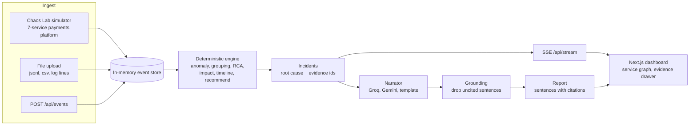

# J.A.R.V.I.S.

Justified Analysis, Reasoning & Visualization of Incident Systems. NITS Hacks 9.0, Software Track, PS1.

**Many alerts, one cause, and every claim shows its evidence.**

## The problem

When a shared dependency fails in a payments platform, every service that touches it starts alerting. Postgres runs out of connections, and within three seconds the auth team is paged for failed logins, the payments team for failed transactions, and the platform team for gateway latency. Three teams start debugging three symptoms. The first alert to fire is often the gateway, which is the one service that is certainly not the cause.

J.A.R.V.I.S. groups related alerts into one incident, ranks root-cause candidates with a deterministic, explainable score, shows the evidence behind every number, and writes a short report in plain language. The LLM never decides anything: it only narrates what the engine already proved, and any sentence it cannot back with an event id is removed. When two causes are equally likely, the system says so instead of guessing.

In the hero scenario (postgres pool exhaustion) 14 alerts collapse into 1 incident with root cause **postgres at confidence 0.80**, with **57 users affected and 38 failed payments worth INR 45,462**.

## Architecture



Simulated system (matches the PS scenario):

```
client -> api-gateway -> auth-svc -> redis-session
                                   -> postgres
          api-gateway -> payments-svc -> ledger-svc -> postgres
                                      -> psp-adapter (external bank)
```

## Run locally

```
python -m venv .venv && .venv/Scripts/pip install -r backend/requirements.txt
cd backend && ../.venv/Scripts/python -m uvicorn app.main:app --reload --port 8000
cd frontend && npm install && npm run dev
```

- Tests: `cd backend && ../.venv/Scripts/python -m pytest -q`
- Regenerate fixtures: `.venv/Scripts/python contracts/gen_fixtures.py`
- Optional LLM keys: `GROQ_API_KEY`, `GEMINI_API_KEY`, and `GEMINI_MODEL` (default `gemini-2.5-flash`). Without keys the app still works fully, using the template narrator.
- The frontend reaches the backend through `NEXT_PUBLIC_API_URL` (for local runs, `http://localhost:8000`).

## How the engine decides

The engine is pure and deterministic: the same events always give the same ranking. No LLM runs inside it.

1. **Anomaly detection.** Per (service, signal): EWMA baseline plus z-score over a rolling window. Alerts and error-log bursts count as anomalies directly. Onset is the first anomalous timestamp.
2. **Grouping.** Anomalous services within a 5 minute window that are connected in the dependency graph form one incident. Disconnected anomalies (for example redis-session failing alone) become separate incidents, so we do not over-group.
3. **Scoring.** Every anomalous service in the incident is a candidate. Its score is the sum of four weighted components, times a victim penalty.

| Component | Weight | Formula |
|---|---|---|
| upstream | 0.40 | anomalous services that transitively call it / (anomalous count - 1) |
| precedence | 0.30 | share of its anomalous transitive callers whose onset is later than its own (0 if it has none) |
| change | 0.20 | 1 if a change event (deploy, config) hit it within 10 min before its onset |
| severity | 0.10 | its peak z / max peak z in the incident |

**Victim penalty:** if a candidate has an anomalous dependency of its own, its score is multiplied by 0.5. It is probably a victim, not the cause.

`score = (upstream + precedence + change + severity) * penalty`. Components are stored already weighted, and each one records the event ids that produced it, so the UI can show why every bar is as tall as it is.

4. **Hero example.** postgres: every other failing service depends on it (upstream 0.40), it failed before all of them (precedence 0.30), no deploy (change 0), strongest anomaly (severity 0.10). Score **0.80**. ledger-svc, payments-svc and auth-svc each depend on something already failing, so they are halved to 0.30, 0.25 and 0.25. The gateway paged first and the postgres alert fired sixth: alert order is not causal order, so onsets come from metrics and logs.
5. **Impact, timeline, recommendations.** Impact is the anomalous set plus every upstream caller to the edge; users are unique `user_id`s on failed requests; failed payments and their INR value come from payments request events. The timeline sorts onsets and marks each with the nearest failing dependency that started earlier. Recommendations come from a rule table keyed by (root tier, signature), and each carries evidence ids.

## The abstain rule

If `top1.score - top2.score < 0.15` **or** `top1.score < 0.45`, the incident is `ABSTAINED`. No root cause is named, the UI shows both candidates, and the incident lists what data would settle it.

Example (`contracts/fixtures/incident_ambiguous.json`): ledger-svc deploys v4.2.0 with a migration, and 31 s later ledger-svc writes fail on lock timeouts. postgres lock waits cross the threshold last only because they are sampled every 2 s.

- postgres: upstream 0.40 + precedence 0 (it crossed its threshold after its callers) + change 0 + severity 0.10 = **0.500**
- ledger-svc: upstream 0.267 + precedence 0.30 + change 0.20 + severity 0.10 = 0.867, halved by the victim penalty (it depends on postgres, which is also anomalous) = **0.433**

The margin is 0.067, below 0.15, so J.A.R.V.I.S. declines to pick. It asks for the lock holder in `pg_stat_activity`, the ledger-svc error rate split by version, and `pg_lock_wait_ms` at 1 s resolution. Its recommendations stay cheap and reversible (roll back the canary and watch lock waits). A guess here would send one team down the wrong path; abstaining tells the on-call exactly what to look at next.

## The narrator and grounding

`POST /api/incidents/{id}/report` builds a short report for the on-call engineer.

- Providers in order: Groq `openai/gpt-oss-120b` (JSON mode, low reasoning effort, override with `GROQ_MODEL`), then Gemini Flash (JSON mime type), then a deterministic template. One total budget of 8 s covers both LLM attempts. A missing key skips that provider; any timeout, HTTP error, bad JSON or schema mismatch falls through to the next one. The endpoint never fails because of an LLM.
- The model gets a compact JSON view of the incident (times already in IST) and must return `{summary, sentences:[{text, cites}]}`.
- **Grounding** drops a sentence when it has no cites, when any cite is not in `incident.evidence_events`, or (for OPEN incidents) when it talks about the cause and names a service other than the engine's root cause. The response carries `dropped`, shown in the UI as "N unsupported sentences removed".
- If nothing survives, the template is used. The template is built from engine output, so it is grounded by construction and reads well with no LLM at all. Em dashes are stripped from everything.
- Reports are cached per (incident id, `updated_at`), so repeated clicks are instant.

## API

| Method | Path | Purpose |
|---|---|---|
| GET | `/health` | liveness and version |
| POST | `/api/events` | batch ingest a list of Event |
| POST | `/api/upload` | multipart file: .jsonl, .csv or plain log lines |
| GET | `/api/topology` | services and dependency edges |
| GET | `/api/incidents` | list of IncidentSummary |
| GET | `/api/incidents/{id}` | full Incident: candidates, evidence events, impact, timeline |
| POST | `/api/incidents/{id}/report` | grounded narrative `{summary, sentences, dropped, provider}` |
| POST | `/api/sim/start` | start simulated traffic |
| POST | `/api/sim/fault` | inject `db_pool_exhaustion`, `bad_deploy`, `redis_down`, `red_herring` or `psp_slow` |
| POST | `/api/sim/reset` | clear faults and the store |
| GET | `/api/stream` | SSE: `event`, `incident_update`, `topology_state` |

Shapes are defined once in `contracts/schemas.py` (pydantic) and mirrored in `contracts/types.ts`.

## Deploy

- **Backend on Render.** `render.yaml` at the repo root defines the free web service: `pip install -r backend/requirements.txt`, then `cd backend && uvicorn app.main:app --host 0.0.0.0 --port $PORT`, health check `/health`, Python 3.11. Set `GROQ_API_KEY` and `GEMINI_API_KEY` in the Render dashboard (optional), and `CORS_ORIGINS` to the Vercel URL.
- **Frontend on Vercel.** Root directory `frontend`, env `NEXT_PUBLIC_API_URL` set to the Render URL. The contracts copy in `frontend/lib/contracts/` is committed, so the build does not need files outside `frontend/`.

## Repo layout

```
contracts/            schemas.py (pydantic), types.ts, gen_fixtures.py, fixtures/*.json
backend/app/
  main.py             FastAPI app, CORS, routers
  schemas.py          imports contracts/ for the backend
  store.py            in-memory event store + incident cache
  ingest/             API ingest, upload parsers
  sim/                topology, traffic generator, fault injectors
  engine/             anomaly, grouping, rca, impact, timeline, recommend
  narrate/            llm.py (Groq, Gemini, template), grounding.py, template.py, router.py
backend/tests/        contract, engine scenario and narrator tests
frontend/             Next.js dashboard and incident report view
docs/ppt_content.md   slide content draft
DECISIONS.md          every non-obvious choice, with time and reason
FAILURES.md           bugs and dead ends, with what we learned
render.yaml           Render blueprint
```
