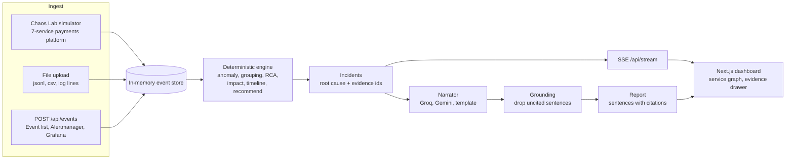

# J.A.R.V.I.S.

**Many alerts. One cause. Proof attached.**

Justified Analysis, Reasoning & Visualization of Incident Systems

> **NITS Hacks 9.0, Software Track, Problem Statement 1** [[R1]](docs/REFERENCES.md#problem-statistics) | Team StrawHats

*Our AI is not allowed to decide anything. It can only explain what the math proved.*

---

## The Problem

When one shared dependency fails, every service that touches it starts alerting. The database runs out of connections, and within seconds the auth team is paged for failed logins, the payments team for failed transactions, and the platform team for a slow gateway. Three teams debug three symptoms of one cause, and the first alert to fire is usually the gateway, the one service that is certainly not the cause.

| What happened | Figure |
|---|---|
| UPI outage, 12 Apr 2025 | Transaction success fell to **about 50% for nearly two hours**; NPCI traced it to some banks overusing one API [[R2]](docs/REFERENCES.md#problem-statistics) [[R3]](docs/REFERENCES.md#problem-statistics) |
| AWS us-east-1, 19 to 20 Oct 2025 | A DNS race condition in DynamoDB cascaded into dependent services from 11:48 PM to 2:20 PM PDT the next day [[R4]](docs/REFERENCES.md#problem-statistics) |
| Our hero scenario (simulated) | **14 alerts across 5 services** from one postgres fault; the gateway pages first, postgres sixth [[E3]](docs/REFERENCES.md#hero-and-ambiguous-scenarios-engine-output) |

## The Solution

J.A.R.V.I.S. turns an alert storm into one incident with a named, provable root cause. It works in four steps:

1. **Ingest:** events arrive from the events API, Alertmanager or Grafana webhooks, uploaded log files, or the built-in Chaos Lab simulator.
2. **Group:** anomalous services that are connected in the dependency graph and go bad within 5 minutes of each other become one incident.
3. **Decide:** a deterministic score ranks every candidate, and every number links to the raw events that produced it.
4. **Explain:** an LLM writes the report, and a guardrail removes any sentence that does not cite evidence.

### Core Innovation: the engine decides, the AI only explains

Each candidate service is scored on four weighted clues [[E1]](docs/REFERENCES.md#engine-design-constants):

| Clue | Weight | Question it answers |
|---|---|---|
| **Upstream** | 0.40 | How many of the other broken services depend on it? |
| **Precedence** | 0.30 | Did it go bad before the services that depend on it? |
| **Change** | 0.20 | Was it deployed or changed shortly before it broke? |
| **Severity** | 0.10 | How strong is its anomaly? |

**Decision rules:**

| Result | When |
|---|---|
| **Victim** | The service's own dependency is also broken: its score is multiplied by 0.5, and the report names it as a victim ("do not roll back") |
| **Root cause** | The top score is at least 0.45 and at least 0.15 ahead of the runner-up |
| **Abstain** | Anything else: both candidates are shown, with the data that would settle it [[E4]](docs/REFERENCES.md#hero-and-ambiguous-scenarios-engine-output) |

In the hero scenario postgres scores **0.80**, and its victims score 0.30, 0.25 and 0.25 [[E3]](docs/REFERENCES.md#hero-and-ambiguous-scenarios-engine-output).

### Honesty by design

| Risk | How it is handled |
|---|---|
| The LLM invents a cause | The LLM never decides. A sentence that cites no event, or an event outside the incident, is removed and counted ("Guardrail blocked N uncited sentences") |
| "You wrote both halves" | **Judge's Chaos** injects a hidden random fault into an isolated sandbox; the engine answers before the spec is revealed |
| A recent deploy gets blamed | Decoy deploys are part of the blind tests, and "Why not X?" explains each ruled-out service with the engine's own numbers |
| Cherry-picked accuracy | 100 blind runs against 3 baselines, weights frozen before the eval, results committed as generated [[E5]](docs/REFERENCES.md#evaluation) |
| A plain LLM would do just as well | Naive AI mode shows a plain LLM's answer next to ours, with its measured accuracy underneath [[E6]](docs/REFERENCES.md#evaluation) |
| A typed number on screen | Every score, MTTD, MTTR and accuracy figure is computed; each one is traced in [docs/REFERENCES.md](docs/REFERENCES.md) |

### Results (our simulator, 100 blind randomized outages)

| Method | Top-1 | False blame |
|---|---|---|
| **J.A.R.V.I.S.** | **100%** | **0%** |
| Blame the latest deploy | 25% | 75% |
| Blame the noisiest service | 47% | 53% |
| Plain LLM, same events (n=40) | 78% | 0% |

The plain LLM was right every time it answered; its 9 missing answers were API rate limits [[E6]](docs/REFERENCES.md#evaluation). So the honest pitch is: **the same accuracy as the LLM where it answers, but every claim is auditable, and it abstains on purpose.** These results come from our own simulator, which spreads faults cleanly from cause to symptoms. Real labelled failures are harder; see the RCAEval section below. The full table and the weight sensitivity are in `eval/RESULTS.md` [[E5]](docs/REFERENCES.md#evaluation) [[E7]](docs/REFERENCES.md#evaluation).

### Real data: RCAEval RE1-OB (125 labelled failures)

Our own simulator spreads faults cleanly, so we also ran the engine on real labelled failures from the Online Boutique microservice system [[R5]](docs/REFERENCES.md#benchmark-and-industry-practice). It is metrics only, with cpu, mem, disk, delay and loss faults. We tuned on 75 cases and report 50 held-out cases, measured once after the changes were frozen [[E12]](docs/REFERENCES.md#real-data-rcaeval-re1-ob):

| Held-out TEST (50 cases) | AC@1 | AC@3 | Avg@5 | False blame |
|---|---|---|---|---|
| Engine before | 24.0% | 52.0% | 44.4% | 34.0% |
| Engine after (two anomaly-detection changes) | **48.0%** | 60.0% | 59.2% | **20.0%** |

Chance is about 8% (1 of 12 services). The live engine above has to find the failure time on its own. The published RCAEval methods are given the failure time, so we added a mode for that case: when you know when it broke, `given_time.py` ranks services by how far each one's metrics moved from its own recent normal (median before vs after, the robust scoring BARO uses [[R7]](docs/REFERENCES.md#benchmark-and-industry-practice)). Tuned on DEV, then run once on TEST [[E14]](docs/REFERENCES.md#real-data-rcaeval-re1-ob):

| Held-out TEST (50 cases), failure time given | AC@1 | AC@3 | Avg@5 | False blame |
|---|---|---|---|---|
| J.A.R.V.I.S. given-time mode | **90.0%** | 94.0% | **94.8%** | **2.0%** |

Per fault on TEST, Avg@5 is 100% for cpu, mem and delay, 96% for disk and 78% for loss, in the same range as the published BARO numbers (0.67 to 1.00 per fault) on this data [[R7]](docs/REFERENCES.md#benchmark-and-industry-practice). It is the same family of method, so matching it is the expected result, not a new state of the art. In the product it runs as a **second opinion** on every incident report (`GET /api/incidents/{id}/shift_check`): it ignores the dependency graph, so when it agrees with the engine, two different methods point at the same service. The full protocol, per-fault tables and the reproduce commands are in `eval/rcaeval/RESULTS.md`.

### What it looks like

- **Live dashboard** (`/dashboard`): the service graph lights up the failure path, and the root cause card shows confidence, score components, evidence chips and why-not lines.
- **Lifecycle:** DETECTED, SPREADING, CAUSE_IDENTIFIED, MITIGATING, RESOLVED. MTTD and MTTR are measured outside the engine [[E9]](docs/REFERENCES.md#tests-and-live-checks).
- **Apply fix:** the simulator heals only when the fix matches the real fault, so a wrong diagnosis cannot fake a recovery.
- **Case study** (`/`): the engineering write-up, rendered from the engine's own output.

## Architecture



Simulated system (matches the PS scenario):

```
client -> api-gateway -> auth-svc -> redis-session
                                   -> postgres
          api-gateway -> payments-svc -> ledger-svc -> postgres
                                      -> psp-adapter (external bank)
```

### Deliberate Architectural Decisions

| Decision | Choice | Why not the alternative |
|---|---|---|
| **Who decides** | A deterministic weighted score on the dependency graph | An LLM verdict cannot be audited and can change between reruns |
| **LLM** | Groq `openai/gpt-oss-120b` in JSON mode, then Gemini 2.5 Flash, then a template | With the 8 s budget the report never fails, and the template needs no network [[E2]](docs/REFERENCES.md#engine-design-constants) [[E10]](docs/REFERENCES.md#tests-and-live-checks) |
| **Contracts** | One pydantic schema mirrored in TypeScript; fixtures generated by the real engine | Hand-written fixtures drifted from the engine twice (see FAILURES.md) |
| **Storage** | An in-memory event window | No database to run for a demo; the engine is pure and replays any event list |
| **Live updates** | Server-Sent Events | A one-way stream needs no socket server and works on free hosting |
| **Blind tests** | An isolated, fast-forwarded sandbox per run | Several judges on one link never collide with each other or with the live Chaos Lab |
| **Deploy** | Render (API) and Vercel (UI) | Free tiers; the backend pins the exact tested dependency versions |

## Quick Start

```
python -m venv .venv && .venv/Scripts/pip install -r backend/requirements.txt
cd backend && ../.venv/Scripts/python -m uvicorn app.main:app --reload --port 8000
cd frontend && npm install && npm run dev
```

- Tests: `cd backend && ../.venv/Scripts/python -m pytest -q`
- Regenerate fixtures: `.venv/Scripts/python contracts/gen_fixtures.py`
- Optional LLM keys: `GROQ_API_KEY`, `GEMINI_API_KEY`, and `GEMINI_MODEL` (default `gemini-2.5-flash`). Without keys the app still works fully, using the template narrator.
- The frontend reaches the backend through `NEXT_PUBLIC_API_URL` (for local runs, `http://localhost:8000`).

- Tests: **278 passing** [[E8]](docs/REFERENCES.md#tests-and-live-checks). Evaluation: `python eval/run_eval.py --seeds 0-99 --llm-n 40` (add `--no-llm` to skip the paced LLM baseline).

## Webhook ingest (Alertmanager and Grafana)

`POST /api/events` still takes a JSON list of Event, and also takes an Alertmanager or Grafana webhook body unchanged. The shape decides: Grafana bodies carry `orgId` or `title`; Alertmanager bodies carry `receiver` or `groupKey` and no `orgId`. Each entry in `alerts[]` becomes one `kind="alert"` event: service from `labels.service` (else `labels.job`), time from `startsAt`, name from `labels.alertname`, message from `annotations.summary`, severity from `labels.severity` (`warning` becomes `warn`). A resolved alert becomes an `info` event. Event ids are a hash of the alert fingerprint, `startsAt` and status, so re-sending a webhook is deduplicated.

```
curl -X POST http://localhost:8000/api/events \
  -H "Content-Type: application/json" \
  --data @contracts/fixtures/alertmanager_webhook.json
# {"accepted":3,"rejected":0,"errors":[]}

curl -X POST http://localhost:8000/api/events \
  -H "Content-Type: application/json" \
  --data @contracts/fixtures/grafana_webhook.json
# {"accepted":2,"rejected":0,"errors":[]}
```

To point a real Alertmanager at it, add a receiver with `webhook_configs: [{url: "https://<backend>/api/events"}]`. For Grafana, create a webhook contact point with the same URL.

## OpenTelemetry ingest (OTLP/JSON logs and metrics)

`POST /api/events` also takes an OTLP/JSON export as-is, detected by shape. `resourceLogs[].scopeLogs[].logRecords[]` become `kind="log"` events: service from the resource attribute `service.name`, time from `timeUnixNano`, severity from `severityText` (else `severityNumber`), message from `body.stringValue`. `resourceMetrics[].scopeMetrics[].metrics[]` gauge and sum data points become `kind="metric"` events named after the metric, value from `asDouble` or `asInt`. Ids hash the content, so a re-sent export is deduplicated. Other shapes still return 422.

```
curl -X POST http://localhost:8000/api/events \
  -H "Content-Type: application/json" \
  --data @contracts/fixtures/otlp_logs.json
# {"accepted":5,"rejected":0,"errors":[]}

curl -X POST http://localhost:8000/api/events \
  -H "Content-Type: application/json" \
  --data @contracts/fixtures/otlp_metrics.json
# {"accepted":7,"rejected":0,"errors":[]}
```

An OpenTelemetry Collector can send here with the `otlphttp` exporter set to `encoding: json`; set its `logs_endpoint` and `metrics_endpoint` to `https://<backend>/api/events`.

## Grounding catches impossible causal claims

Besides dropping sentences with unknown citations, the narrator's validator drops any sentence that says one service caused, led to or broke another when the topology makes that impossible: "X caused Y" survives only if Y depends on X, directly or through other services. A fully cited "ledger-svc errors led to auth-svc failures" is dropped because auth-svc never calls ledger-svc. Each drop counts in the report's `dropped`.

## Live faults expire

A Chaos Lab fault ends on its own after `FAULT_TTL_S` seconds (default 180) and leaves `active_faults`. The simulator then recovers the same way it does after a fix, but writes no `fix_applied` event, so the engine sees the metrics heal (lifecycle goes to RESOLVED) without ever believing someone fixed it. The live store also resets itself after `IDLE_RESET_S` seconds (default 600) with no `/api` request, if there is anything to clear. Set either to `0` to turn it off. Sandbox runs are not affected. This keeps one visitor's forgotten fault from degrading the next visitor's view, and keeps every fault shorter than the 15 minute event window.

## Seen this before (incident similarity)

The store keeps the last 50 incidents that ended (RESOLVED, or dropped from the live list by a reset, a fault expiry or the engine replacing them), plus every sandbox-run incident. The history survives `/api/sim/reset`. Each incident's `similar` lists up to 3 past incidents, most similar first:

`similarity = 0.5 (same root service) + 0.3 (same root signature) + 0.2 x Jaccard(service sets)`, rounded to 2 dp, listed only when at least 0.5. An incident is never compared with itself. The code is `backend/app/similar.py`, outside the engine.

## API

| Method | Path | Purpose |
|---|---|---|
| GET | `/health` | liveness and version |
| POST | `/api/events` | batch ingest a list of Event, an Alertmanager or Grafana webhook body, or OTLP/JSON logs or metrics, as-is |
| POST | `/api/upload` | multipart file: .jsonl, .csv or plain log lines |
| GET | `/api/topology` | services and dependency edges |
| GET | `/api/incidents` | list of IncidentSummary |
| GET | `/api/incidents/{id}` | full Incident: candidates, evidence events, impact, timeline |
| POST | `/api/incidents/{id}/report` | grounded narrative `{summary, sentences, dropped, provider}` |
| GET | `/api/incidents/{id}/naive` | Naive AI mode: `{provider, model, root_cause_service, raw_text, latency_ms, measured}`; `measured` is the llm_only top-1 and n from `eval/results.json`, null until the eval has run |
| POST | `/api/runs/blind`, `/api/runs/designed` | sandbox runs (spec hidden, or a FaultSpec you design) |
| GET | `/api/runs/{id}/reveal` | injected FaultSpec and whether our #1 matched |
| GET | `/api/eval/results` | EvalResults, served from `eval/results.json` |
| POST | `/api/sim/start` | start simulated traffic |
| POST | `/api/sim/fault` | inject `db_pool_exhaustion`, `bad_deploy`, `redis_down`, `red_herring` or `psp_slow` |
| POST | `/api/sim/reset` | clear faults and the store |
| GET | `/api/stream` | SSE: `event`, `incident_update`, `topology_state` |

Shapes are defined once in `contracts/schemas.py` (pydantic) and mirrored in `contracts/types.ts`.

## Deploy

- **Backend on Render.** `render.yaml` at the repo root defines the free web service: `pip install -r backend/requirements.txt`, then `cd backend && uvicorn app.main:app --host 0.0.0.0 --port $PORT`, health check `/health`, Python 3.12.6 (pinned to the tested version). Set `GROQ_API_KEY` and `GEMINI_API_KEY` in the Render dashboard (optional), and `CORS_ORIGINS` to the Vercel URL.
- **Frontend on Vercel.** Root directory `frontend`, env `NEXT_PUBLIC_API_URL` set to the Render URL. The contracts copy in `frontend/lib/contracts/` is committed, so the build does not need files outside `frontend/`.

## Progress

**14 of 14 planned items built (100%)** [[E11]](docs/REFERENCES.md#project-progress). Built: simulator and ingest, deterministic engine, live dashboard, grounded narrator, upgrades U1 to U7, and for the final round OpenTelemetry (OTLP) ingest and incident similarity ("seen this before"), plus the RCAEval real-data benchmark (125 Online Boutique failures, held-out split).

## Repo layout

```
contracts/            schemas.py (pydantic), types.ts, gen_fixtures.py, fixtures/*.json
backend/app/
  main.py             FastAPI app, CORS, routers
  schemas.py          imports contracts/ for the backend
  store.py            in-memory event store + incident cache
  ingest/             API ingest, upload parsers, Alertmanager/Grafana webhooks
  sim/                topology, traffic generator, fault injectors
  engine/             anomaly, grouping, rca, impact, timeline, recommend
  narrate/            llm.py (Groq, Gemini, template), grounding.py, template.py, router.py,
                      naive.py (frozen naive prompt, compact_events, /naive endpoint)
backend/tests/        contract, engine scenario, narrator, naive mode and webhook tests
eval/                 run_eval.py, results.json, RESULTS.md (generated)
frontend/             Next.js dashboard and incident report view
docs/REFERENCES.md    source or generating command for every number we claim
docs/ppt_content.md   slide content draft
DECISIONS.md          every non-obvious choice, with time and reason
FAILURES.md           bugs and dead ends, with what we learned
render.yaml           Render blueprint
```
